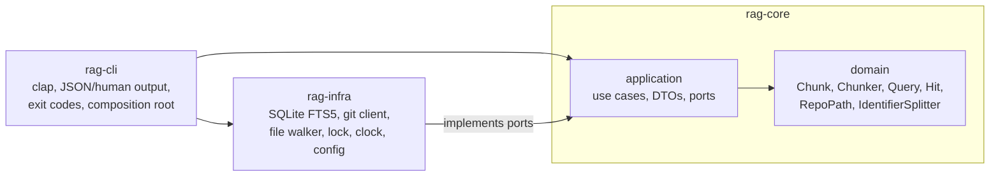
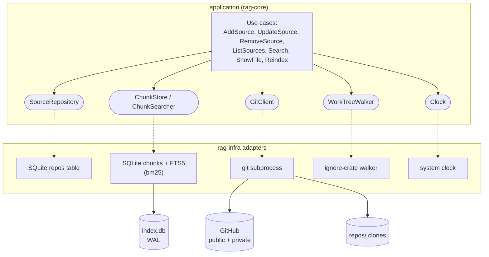
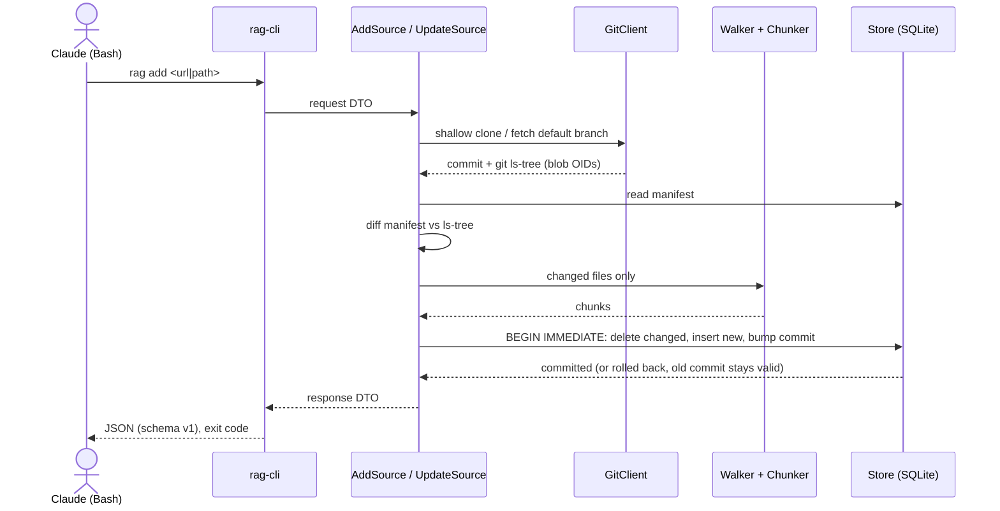
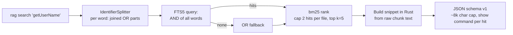
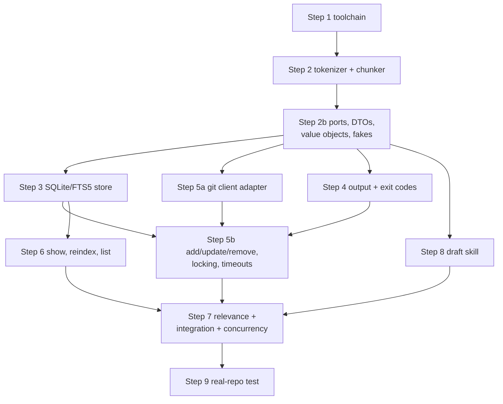

# System design

Diagrams for `rag`. PLAN.md is the source of truth for behaviour; this file is the picture. Each diagram is given twice: Mermaid (renders on GitHub and in most editors) and ASCII (renders anywhere).

## 1. Layers (onion architecture)



```
        +-----------------------------------------------+
        | rag-cli   clap | JSON/--human | exit codes    |   composition root
        +----------------------+------------------------+
                               | wires
        +----------------------v------------------------+
        | rag-infra   SQLite/FTS5 | git | walker | lock |   implements the ports
        |             clock | config (RUSTY_RAG_HOME)   |
        +----------------------+------------------------+
                               | depends on (inward only)
        +----------------------v------------------------+
        | rag-core                                      |
        |  +-----------------------------------------+  |
        |  | application: use cases, DTOs, PORTS     |  |
        |  |  +-----------------------------------+  |  |
        |  |  | domain: Chunk, Chunker, Query,    |  |  |
        |  |  | Hit, RepoPath, IdentifierSplitter |  |  |
        |  |  | (no I/O, no serde, no clock)      |  |  |
        |  |  +-----------------------------------+  |  |
        |  +-----------------------------------------+  |
        +-----------------------------------------------+
```

## 2. Components and ports



```
 Use cases (application)         Ports (traits)            Adapters (rag-infra)      Outside world
 -----------------------         --------------            --------------------      -------------
 AddSource    --------+         SourceRepository  <.....   SQLite repos table  ----> index.db (WAL)
 UpdateSource --------+         ChunkStore        <.....   SQLite chunks+FTS5  ----> index.db (WAL)
 RemoveSource --------+-uses->  ChunkSearcher     <.....   FTS5 bm25 query
 ListSources  --------+         GitClient         <.....   git subprocess      ----> GitHub, repos/ clones
 Search       --------+         WorkTreeWalker    <.....   ignore-crate walker ----> working tree files
 ShowFile     --------+         Clock             <.....   system clock
 Reindex      --------+
```

## 3. Add / update flow



```
 rag add/update
   |
   v
 [rag-cli] parse args --> request DTO
   |
   v
 [use case] --> GitClient: shallow clone or fetch default branch (no lock held)
   |                  \--> commit id + `git ls-tree -r` (blob OIDs)
   v
 read Manifest from store --> diff against ls-tree --> changed / removed paths
   |
   v
 Walker + Chunker: changed files only (gitignore, size, binary, denylist filters)
   |
   v
 Store: BEGIN IMMEDIATE  (the single writer lock, held only here)
          delete changed + removed, insert new chunks + FTS rows, bump commit
        COMMIT  (a crash rolls back; old commit stays consistent)
   |
   v
 response DTO --> JSON --> exit code (0 ok, 3 not found, 4 auth/network, 6 locked ...)
```

## 4. Search flow



```
 query --> IdentifierSplitter (per word: joined OR parts)
       --> FTS5 AND query --hits--> bm25 rank
                |no hits
                +--> OR fallback --> bm25 rank
       --> cap: 2 hits per file, top k (default 5)
       --> snippet built in Rust from raw chunk text (match-centred, ~600 chars)
       --> JSON schema v1, output capped near 8k chars, `show` command per hit
 (search takes no writer lock: one read transaction on the WAL database)
```

## 5. Build phases and parallel lanes



```
 Phase A (sequential)   1 toolchain -> 2 tokenizer/chunker -> 2b ports+DTOs+fakes  [freeze]
                                                                  |
 Phase B (4 parallel lanes, one worktree each)  ------------------+-----------------------
                          3 SQLite/FTS5 store | 5a git adapter | 4 output+exit codes | 8 draft skill
                                  |                 |                |                   |
 Phase C                          +--------+--------+----------------+                   |
                                  5b add/update/remove, locking     6 show/reindex/list  |
                                           |                              |              |
 Phase D                                   +---------------+--------------+--------------+
                                                    7 relevance + integration + concurrency
                                                                  |
                                                       9 real-repo test and tuning
```

## 6. On-disk layout

```
 RUSTY_RAG_HOME  (default: %LOCALAPPDATA%\rag | ~/Library/Application Support/rag | ~/.local/share/rag)
   index.db        SQLite, WAL: meta, repos, files, chunks, chunks_fts
   repos/<id>/     shallow clones of the default branch (read by `show` via git cat-file)
   tmp/            in-progress clones, cleaned on next start
```
